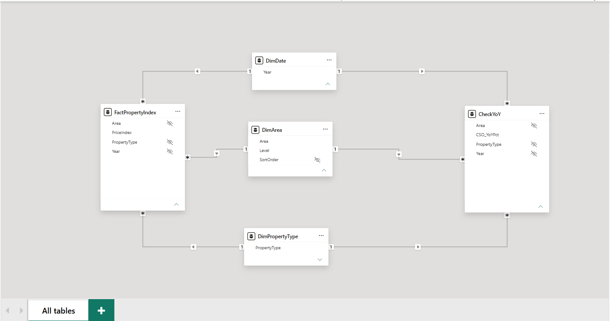

# Data Model Notes

## Structure

Star schema with two fact tables sharing three dimension tables.

~~~
                    DimDate
                       |
FactPropertyIndex — DimArea — CheckYoY
                       |
               DimPropertyType
~~~

| Table | Type | Rows | Purpose |
|---|---|---|---|
| FactPropertyIndex | Fact | 420 | Price index values (base Jan 2005 = 100) |
| CheckYoY | Fact | 420 | CSO's published YoY % change, used to check my DAX measure |
| DimArea | Dimension | 14 | Area, Level, SortOrder |
| DimDate | Dimension | 21 | Years 2005–2025 |
| DimPropertyType | Dimension | 3 | houses, apartments, all residential properties |

## Relationships

6 relationships, all many-to-one (fact `*` → dimension `1`), single filter direction
(dimension filters fact), all active. No direct link between the two fact tables.

| From (many) | To (one) | Column |
|---|---|---|
| FactPropertyIndex | DimArea | Area |
| FactPropertyIndex | DimDate | Year |
| FactPropertyIndex | DimPropertyType | PropertyType |
| CheckYoY | DimArea | Area |
| CheckYoY | DimDate | Year |
| CheckYoY | DimPropertyType | PropertyType |

Relationships were auto-detected by Power BI, then checked for the correct columns,
cardinality and filter direction.

## Why DimPropertyType was added

- First version of the model had only DimArea and DimDate.
- A test table combining FactPropertyIndex and CheckYoY failed with
  "Can't determine relationships between the fields".
- Cause: PropertyType had no shared dimension, so Power BI could not match rows
  between the two fact tables by property type.
- Fix: built DimPropertyType in Power Query (Reference FactPropertyIndex →
  keep PropertyType → remove duplicates), so it always matches the data.

## Model settings

**Hidden columns** (so charts always use the dimension version, which filters both fact tables):
- FactPropertyIndex: Area, Year, PropertyType
- CheckYoY: Area, Year, PropertyType
- DimArea: SortOrder (only used for ordering)

**Summarization:** PriceIndex, CSO_YoYPct and SortOrder set to "Don't summarize".
Index values must never be added together.

**Sort order:** DimArea[Area] is sorted by DimArea[SortOrder], so areas show as
national totals → Dublin → Dublin sub-areas → regions, instead of A–Z.

## Test

Table visual with DimArea[Area], DimDate[Year], DimPropertyType[PropertyType],
PriceIndex and CSO_YoYPct, filtered to 2025:
- No errors; each area/property type shows its own values.
- Example: National houses = 164.3 index, 7.6% YoY.
- Note: raw columns needed "Average" in the visual to work across both fact tables.
  DAX measures will replace this in Stage 3.